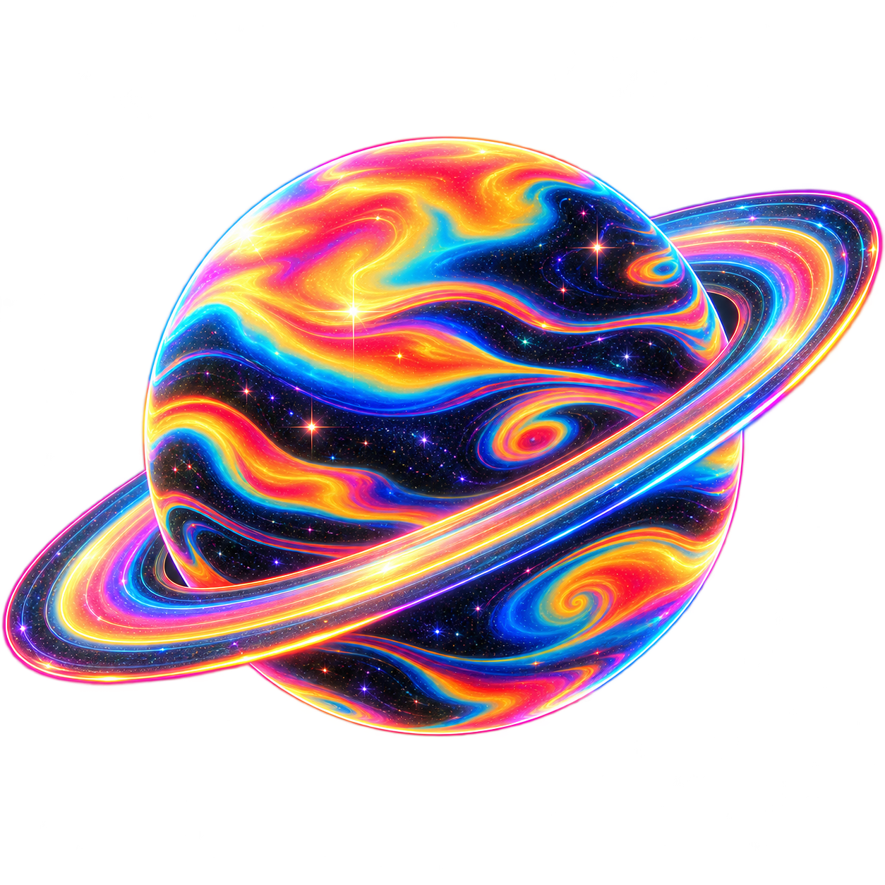

  

  
  &nbsp;
  

<table>
  <tr>
    <td colspan="2">
      <h3>Hey there! I’m Ricardo </h3>
    </td>
  </tr>
  <tr>
    <td width="70%" valign="top">
       
      <strong>Welcome to my little corner of the universe.</strong>
        
      This is where I share what I build, explore new ideas, and keep track of the things I learn along the way.
        
      Take a look around — you might find your next spark of inspiration.
        
      <a href="https://github.com/ricardious?tab=repositories">Explore my projects →</a>
        
    </td>
    <td width="30%" align="center" valign="middle">
      
    </td>
  </tr>
</table>

A little curiosity. A new orbit.

